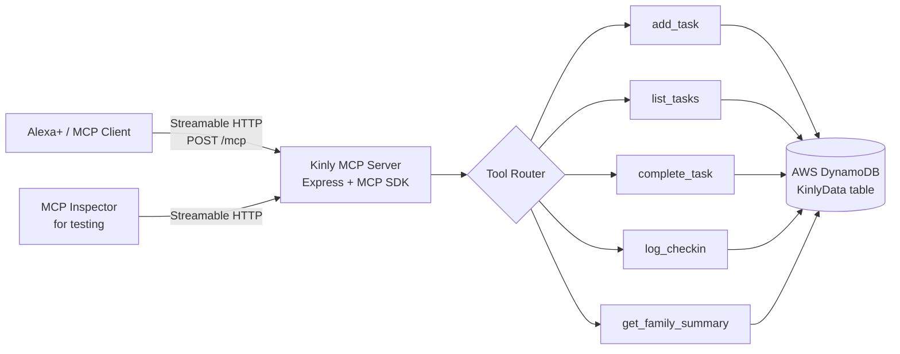

# Kinly

A family coordination and care check-in assistant, built as a self-hosted MCP server for the **Alexa+** track of the Build, Ship, Shape: Amazon Developer Hackathon.

## The problem

Families managing everyday household logistics (chores, errands) alongside caretaking for a relative (medication reminders, wellness check-ins) often juggle multiple disconnected apps, with no shared memory between family members.

## What it does

Kinly exposes a small set of MCP tools that give an assistant persistent, shared family memory:

- **add_task** — add a shared household task or errand
- **list_tasks** — list all open household tasks
- **complete_task** — mark a task done by matching its text
- **log_checkin** — log a wellness or medication check-in for a family member
- **get_family_summary** — a combined natural-language view of open tasks, recent check-ins, and overdue alerts for anyone who hasn't checked in within 24 hours

State persists across sessions and across different people asking, backed by AWS DynamoDB, so one family member can log something and another can ask about it later, from anywhere.

## Architecture



Every tool call reads the full family state from DynamoDB, applies its change, and writes it back. This keeps the server itself stateless between requests, state lives in DynamoDB, not in server memory, so any family member connecting from anywhere sees the same shared, up-to-date picture.

## Tech stack

- Node.js + TypeScript
- `@modelcontextprotocol/sdk` (stable v1 generation, verified to negotiate MCP protocol version 2025-11-25)
- Express, with the Streamable HTTP transport
- Zod for input validation
- AWS DynamoDB for persistent, shared storage (AWS Builder mini challenge)

## Design Decisions

**MCP over a custom REST API.** MCP gives Kinly a standardized tool-calling contract that any MCP-compatible assistant, not just Alexa+, can use without custom integration work.

**Stable v1 SDK over the newer v2.** The v2 generation of the MCP TypeScript SDK is explicitly labeled alpha/pre-alpha by its maintainers. Given a hard hackathon deadline, the stable v1 SDK was the lower-risk choice, and it was verified (see Testing below) to still negotiate MCP protocol version 2025-11-25, meeting the track requirement.

**DynamoDB over local file storage.** The project started with a local JSON file for speed during initial development, then migrated to AWS DynamoDB so family state is genuinely shared and durable across devices and sessions, not tied to one machine's disk. This also fulfills the AWS Builder mini challenge.

**Text-matching for `complete_task` instead of IDs.** In a voice interface, a person can't read back a UUID. Matching by task text (e.g., "mark milk as done") is far more natural to speak. The known tradeoff, ambiguity with duplicate task text, is documented in the friction log and addressed in the Roadmap below.

## Setup

```
npm install
```

## Run the server

```Shell
npx tsx src/index.ts
```

The server listens at `http://localhost:3000/mcp`.

## Testing it

In a separate terminal, run the official MCP Inspector:

```Shell
npx @modelcontextprotocol/inspector
```

In the Inspector UI:

1. Set **Transport Type** to `Streamable HTTP`
2. Set the **URL** to `http://localhost:3000/mcp`
3. Click **Connect**
4. Go to the **Tools** tab to call any of the five tools

## Roadmap / Future Work

- **Web dashboard** as an optional visual companion for family members who prefer glancing at a screen over asking Alexa+
- **Normalized DynamoDB schema**: one item per task/check-in with proper partition and sort keys, instead of the current single JSON blob item, for better scalability
- **Task disambiguation**: unique short IDs or de-duplication on add, to resolve the duplicate-task-name limitation found during testing
- **Multi-household support**: the current single shared data store fits one family; a real product would need per-household isolation and authentication
- **Proactive push notifications** for overdue check-ins, rather than only surfacing them when someone asks for a summary
- **Automated tests and CI** for safer ongoing development

## License

MIT, see LICENSE.

## Hackathon

Built for the Alexa+ track of the Build, Ship, Shape: Amazon Developer Hackathon (2026).
